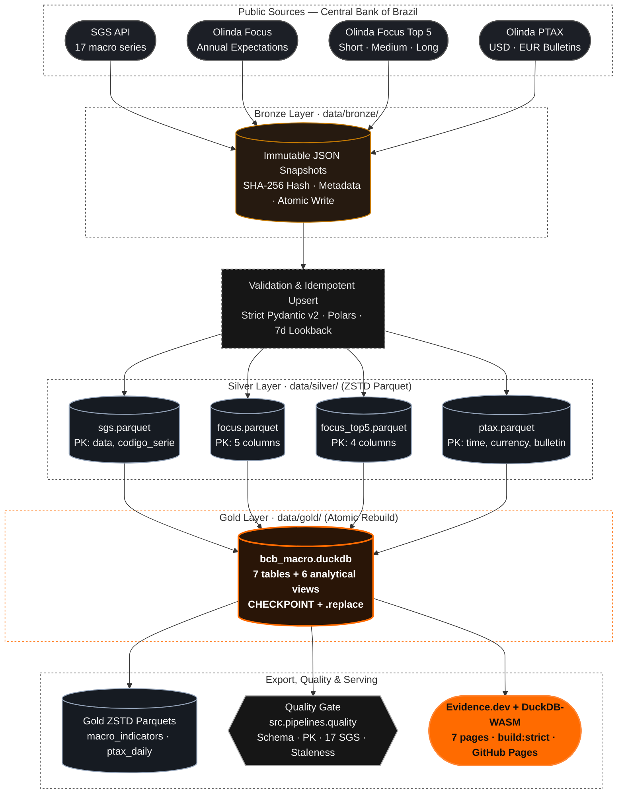

# BCB Macro Lakehouse

Incremental, idempotent batch pipeline that collects public macroeconomic series from the Central Bank of Brazil (BCB), builds Bronze/Silver/Gold lakehouse layers, and publishes a static Evidence.dev analytical dashboard. Built with Python 3.11+, Polars, DuckDB, Pydantic v2, Requests, Ruff, and Pytest.

- **Live dashboard:** <https://leoserpa.github.io/bcb-dados-macro/>
- **Português:** [Leia este documento em português](README.md)

## Quick start

Requirements: `uv` (Python 3.11+ required; `.python-version` pins `3.14` in CI) and Node.js 18+ to build or preview the dashboard in `reports/`.

On Linux/macOS (or equivalent PowerShell commands):

```bash
uv sync --frozen --dev
uv run ruff check .
uv run ruff format --check .
uv run pytest --cov=src --cov-fail-under=85 -q
uv run python -m src.pipelines.run --lookback-days 7 --log-dir logs
```

Validate the generated Gold database:

```bash
uv run python -m src.pipelines.quality \
  --database data/gold/bcb_macro.duckdb \
  --max-staleness-days 10
```

> **Local Python note:** If your host does not have Python 3.14 installed yet, pass `--frozen --python 3.12` to `uv run` (for example, `uv run --frozen --python 3.12 pytest -q`).

## Architecture



Each run writes content-addressed Bronze JSON snapshots with request metadata, performs idempotent Silver upserts that preserve original `ingested_at` timestamps when business columns are unchanged, and atomically rebuilds the Gold layer (`bcb_macro.tmp.duckdb` + `CHECKPOINT` + `.replace()`) only when Silver changes or the DuckDB file is missing. Design rationales and rejected alternatives are recorded in [docs/decisions/](docs/decisions/README.md).

## Data sources

- **SGS (`src/extractors/sgs.py`):** 17 series covering policy rates (`11`, `432`), inflation (`189`, `433`, `13522`), activity and labor (`24364`, `24369`), credit (`20631`, `20714`, `20783`, `21082`), fiscal balance and debt (`4513`, `5793`, `13762`), and external sector (`13967`, `13970`, `13982`), fetched in chunks of up to `3650` days.
- **Focus (`ExpectativasMercadoAnuais`):** annual market expectations for `IPCA`, `Selic`, `Câmbio`, and `PIB Total`, paginated over OData (`page_size = 1000`).
- **Focus Top 5 (`ExpectativasMercadoTop5Anuais`):** annual projections by top forecasters (`tipoCalculo`: `C`, `M`, `L`) across the same 4 indicators.
- **PTAX (`CotacaoMoedaPeriodo`):** intraday FX bulletins defaulting to `USD,EUR` on the CLI (`--currency`); `ptax_daily` prioritizes the `Fechamento` bulletin (falling back to the latest timestamp).

HTTP requests use a `30s` timeout and 3 exponential retries (`2s`, `4s`, `8s`) on status codes `429`, `500`, `502`, `503`, and `504`.

## Layers and Gold assets

| Layer | Location | Contents |
|---|---|---|
| Bronze | `data/bronze/source=*/ingestion_date=*/` | Immutable raw JSON snapshots + SHA-256 |
| Silver | `data/silver/{sgs,focus,focus_top5,ptax}/` | 4 deduplicated ZSTD Parquet datasets |
| Gold | `data/gold/bcb_macro.duckdb` | 7 tables + 6 analytical views |
| Gold Parquet | `data/gold/{macro_indicators,ptax_daily}.parquet` | ZSTD Parquet exports from Gold |

**Gold tables (7):** `sgs_series`, `focus_expectations`, `focus_top5`, `ptax_quotes`, `macro_indicators`, `ptax_daily`, `ptax_risk_metrics`.

**Gold views (6):** `vw_macro_latest`, `vw_focus_repricing`, `vw_macro_regime`, `vw_juro_real_completo`, `vw_focus_top5_vs_geral`, `vw_lakehouse_lineage`.

## Loads and partial failure handling

Initial runs start on `2010-01-01` (`BCB_INITIAL_DATE`). Incremental runs look back `7` days (`--lookback-days`) from the latest persisted date per series or currency to capture late BCB revisions.

Historical backfill:

```bash
uv run python -m src.pipelines.run \
  --start-date 2010-01-01 \
  --end-date 2026-11-25 \
  --currency USD,EUR \
  --log-dir logs
```

Daily incremental run:

```bash
uv run python -m src.pipelines.run --lookback-days 7 --log-dir logs
```

If an upstream source fails, its existing Silver dataset is preserved, the failure is recorded in `failed_sources`, and the CLI exits with status `2` to flag a partial run.

## Dashboard (Evidence.dev + GitHub Pages)

The `reports/` workspace compiles a static **Evidence.dev** analytical terminal with 7 pages (`Panorama`, `Inteligência`, `Juros`, `Inflação`, `Câmbio`, `Focus`, and `Linhagem`), 11 SQL sources under `reports/sources/bcb_macro/`, and 4 custom Svelte components (`KPITerminalCard`, `ExecutiveTable`, `ConditionalTable`, `TerminalLineChart`).

Run or strictly validate locally (Node.js 20+ recommended):

```bash
cd reports
npm ci
npm run sources
npm run build:strict
npm run dev
```

## Automation, quality, and security

- **`.github/workflows/data_pipeline.yml`:** runs Monday through Friday at `12:30 UTC` (`09:30 BRT`) or manually via `workflow_dispatch`. Executes Ruff, Pytest (`--cov-fail-under=85`), ingestion, and the quality gate (`--max-staleness-days 10`), committing `data/` only when outputs change. Logs are written to `logs/pipeline.log` (5 MiB x 5 rotating backups).
- **`.github/workflows/deploy_pages.yml`:** runs `npm run sources && npm run build:strict` and deploys to GitHub Pages after a successful data pipeline run or updates under `reports/` or `data/gold/**`.
- **`.github/workflows/codeql.yml`:** runs static security scanning for Python and GitHub Actions.

## Documentation and governance

- [Documentation in English (Diátaxis)](docs/en/README.md) · [Documentação em português](docs/pt/README.md) · [Bilingual index](docs/README.md)
- [Architecture Decision Records (ADRs 001–004)](docs/decisions/README.md)
- [Changelog](CHANGELOG.md)
- [Contributor and agent conventions (AGENTS.md)](AGENTS.md)
- License: [GNU GPL v3.0](LICENSE)
