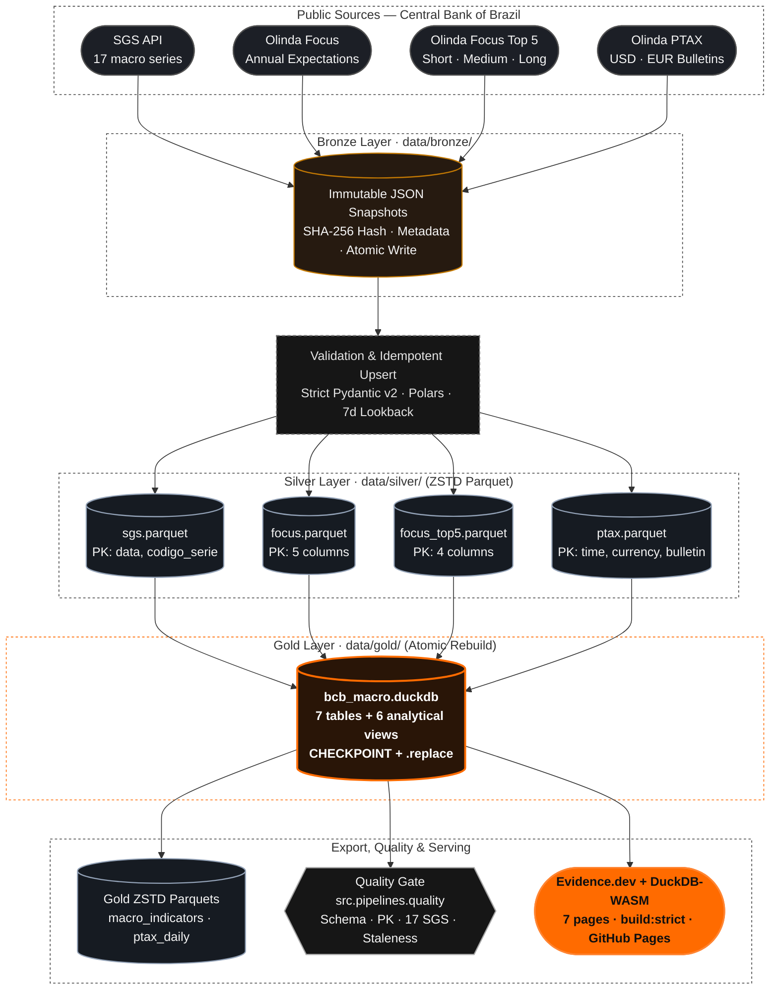
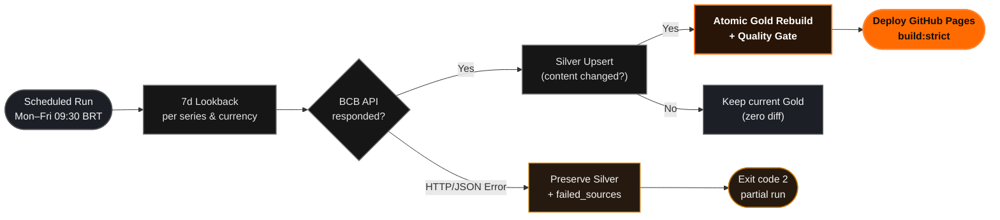

# Architecture explanation

Conceptual overview of how Bronze, Silver, Gold, and Evidence.dev fit together and why those boundaries exist. Concrete trade-offs and rejected alternatives are recorded in [docs/decisions/](../decisions/README.md).

## End-to-end flow overview

## Why use the Medallion Architecture?

The **Bronze** layer stores raw JSON responses from BCB APIs alongside request parameters and a deterministic SHA-256 checksum. **Silver** enforces Pydantic v2 contracts (`extra="forbid"`), parses Brazilian numeric formatting (decimal commas, `"-"`, `"nan"`) into `Float64`, normalizes ISO/UTC dates, and writes deduplicated ZSTD Parquet datasets. **Gold** reads solely from Silver to materialize analytical tables, window metrics, and SQL views in DuckDB.

This separation allows transformations and analytical models to evolve and rebuild cleanly without re-querying historical API ranges ([ADR-001](../decisions/ADR-001-medallion-polars-duckdb-rebuild-atomico.md)).

## How do idempotency and lookback work?

Daily runs neither re-download all history since `2010-01-01` nor assume BCB series never revise recent observations:

- Without `--start-date`, the orchestrator looks back `7` days (`--lookback-days`) from the latest persisted date per SGS series and PTAX currency.
- During Silver consolidation, `upsert_parquet` first deduplicates all business columns keeping the **earliest** `ingested_at`, and then deduplicates on primary key keeping the latest observation.

Late BCB revisions overwrite stale numbers, while unchanged re-fetches keep original timestamps and avoid noisy binary commits in Git ([ADR-002](../decisions/ADR-002-ingestao-incremental-lookback-e-falha-parcial.md)).

## Why rebuild Gold atomically?

Gold combines base copies (`sgs_series`, `focus_expectations`, `focus_top5`, `ptax_quotes`) with full-history window computations (`ptax_risk_metrics`, `vw_macro_regime`, `vw_juro_real_completo`, `vw_focus_repricing`, `vw_focus_top5_vs_geral`). Instead of patching a live database file with incremental DML, `build_gold` constructs `bcb_macro.tmp.duckdb`, runs `CHECKPOINT`, closes the connection, and atomically swaps files only when Silver changes or Gold is missing ([ADR-001](../decisions/ADR-001-medallion-polars-duckdb-rebuild-atomico.md)).

## How are reliability and partial failures handled?

- **HTTP transport:** `30s` timeout and 3 exponential retries (`2s`, `4s`, `8s`) on `429` and `5xx`, plus `3650`-day chunking on SGS queries.
- **Per-source isolation:** if an SGS series, Focus, Focus Top 5, or a PTAX currency fails, `failed_sources` records it, prior Silver data remains untouched, healthy sources still commit to Silver, and the CLI exits with status `2` ([ADR-002](../decisions/ADR-002-ingestao-incremental-lookback-e-falha-parcial.md)).
- **Quality gate and test suite:** `src.pipelines.quality` verifies core schemas, non-nulls, PK uniqueness, all 17 SGS series, all 4 Focus indicators, row counts, and staleness bounds; Pytest enforces `>= 85%` coverage.

## Why Evidence.dev and DuckDB-WASM?

Compiling the dashboard with **Evidence.dev** turns the SQL sources under `reports/sources/bcb_macro/` and `bcb_macro.duckdb` into a static site backed by DuckDB-WASM in the browser, requiring zero runtime backend servers ([ADR-003](../decisions/ADR-003-evidence-static-bi-e-duckdb-wasm.md)). The UI uses neutral dark surfaces with `#ff6b00` as a single focal accent, direct endpoint series labels, and pure typographic conditional formatting ([ADR-004](../decisions/ADR-004-gramatica-visual-editorial-e-formatacao-tipografica.md)).

Versão em português: [Explicação da arquitetura](../pt/explanation.md).
