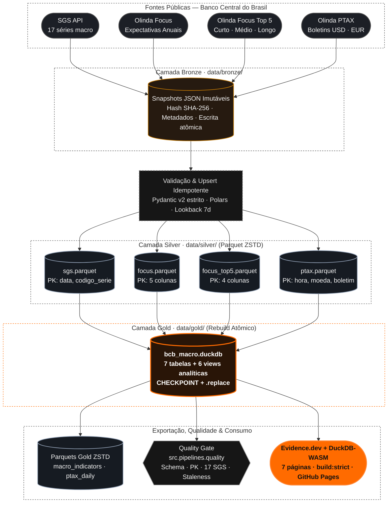
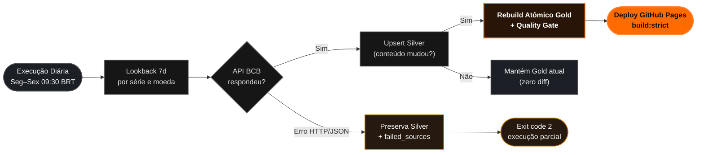

# Explicação da arquitetura

Visão conceitual de como Bronze, Silver, Gold e Evidence.dev trabalham juntos e por que essas fronteiras existem. Os trade-offs e alternativas rejeitadas estão detalhados em [docs/decisions/](../decisions/README.md).

## Visão geral do fluxo

## Por que usar a arquitetura Medallion?

A camada **Bronze** preserva o payload JSON bruto retornado pelas APIs do BCB junto com os parâmetros da requisição e um hash SHA-256 determinístico. A **Silver** impõe contratos Pydantic v2 (`extra="forbid"`), converte strings numéricas brasileiras (vírgula decimal, `"-"`, `"nan"`) para `Float64`, normaliza datas em UTC/ISO e grava arquivos Parquet ZSTD deduplicados por chave primária. A **Gold** lê apenas a Silver para materializar tabelas analíticas, métricas derivadas e views SQL no DuckDB.

Essa separação permite reprocessar regras de transformação e reconstruir a Gold sem refazer centenas de requisições históricas nas APIs do BCB ([ADR-001](../decisions/ADR-001-medallion-polars-duckdb-rebuild-atomico.md)).

## Como funcionam a idempotência e o lookback?

Execuções diárias não baixam todo o histórico desde `2010-01-01` nem dependem de um corte seco sem tolerância a correções:

- Sem `--start-date`, o orquestrador retrocede `7` dias (`--lookback-days`) a partir da maior data persistida por série SGS ou moeda PTAX.
- Ao consolidar na Silver, `upsert_parquet` primeiro deduplica todas as colunas de negócio mantendo o **menor** `ingested_at` e depois deduplica pela chave primária mantendo o registro mais recente.

Assim, revisões tardias do BCB substituem valores antigos, enquanto reconsultas idênticas preservam os hashes e timestamps originais e evitam commits binários sem mudança real de dados ([ADR-002](../decisions/ADR-002-ingestao-incremental-lookback-e-falha-parcial.md)).

## Por que rebuild atômico da Gold?

A camada Gold mistura tabelas diretas (`sgs_series`, `focus_expectations`, `focus_top5`, `ptax_quotes`) com agregações e funções de janela sobre toda a série histórica (`ptax_risk_metrics`, `vw_macro_regime`, `vw_juro_real_completo`, `vw_focus_repricing`, `vw_focus_top5_vs_geral`). Em vez de aplicar `INSERT`/`UPDATE` parciais no banco ativo, `build_gold` constrói `bcb_macro.tmp.duckdb`, executa `CHECKPOINT`, fecha a conexão e substitui os arquivos finais atomicamente somente quando a Silver mudou ou o banco não existe ([ADR-001](../decisions/ADR-001-medallion-polars-duckdb-rebuild-atomico.md)).

## Como confiabilidade e falhas parciais são tratadas?

- **Transporte HTTP:** timeout de `30s` e 3 tentativas com espera fixa de `2s`, `4s` e `8s` em erros transitórios (`429`, `5xx`), além de janelas de no máximo `3650` dias no SGS.
- **Isolamento por fonte:** se uma série SGS, o Focus, o Focus Top 5 ou uma moeda PTAX falhar, `failed_sources` registra o item, o Parquet Silver anterior é mantido íntegro, fontes saudáveis avançam e o CLI encerra com código `2` ([ADR-002](../decisions/ADR-002-ingestao-incremental-lookback-e-falha-parcial.md)).
- **Portão de qualidade e testes:** `src.pipelines.quality` verifica schema, nulos, chaves únicas, as 17 séries SGS, os 4 indicadores Focus, reconciliação de linhas e defasagem máxima; a suíte Pytest exige cobertura mínima de `85%`.

## Por que Evidence.dev + DuckDB-WASM?

Publicar o dashboard em **Evidence.dev** compila as consultas SQL de `reports/sources/bcb_macro/` diretamente sobre `bcb_macro.duckdb` em ativos estáticos executados via DuckDB-WASM no navegador, eliminando servidores Python pagos ou bancos externos ([ADR-003](../decisions/ADR-003-evidence-static-bi-e-duckdb-wasm.md)). A interface segue uma paleta escura neutra com foco único em `#ff6b00`, rótulos diretos nas séries finais e formatação condicional puramente tipográfica ([ADR-004](../decisions/ADR-004-gramatica-visual-editorial-e-formatacao-tipografica.md)).

English version: [Architecture explanation](../en/explanation.md).
